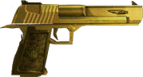
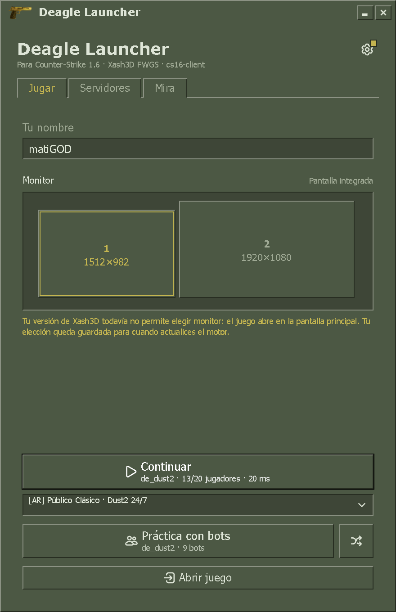
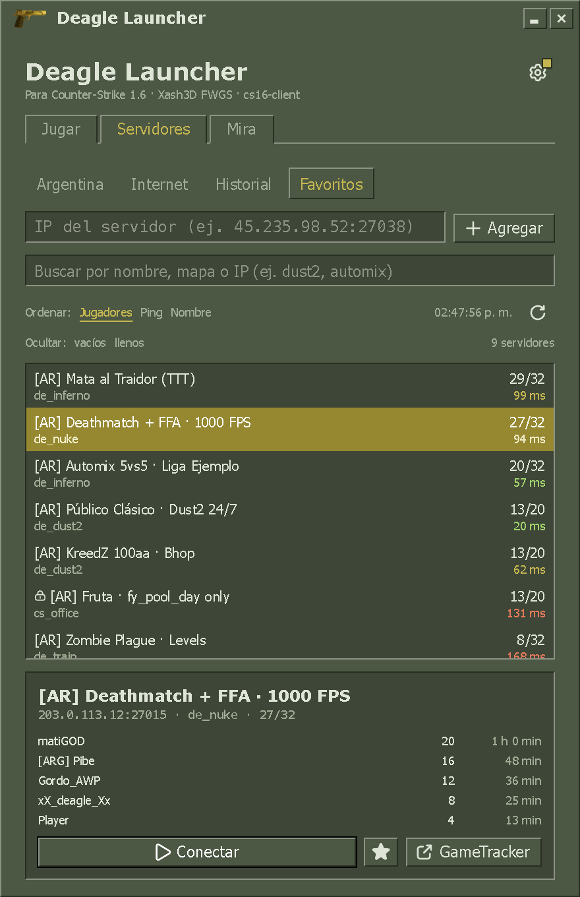
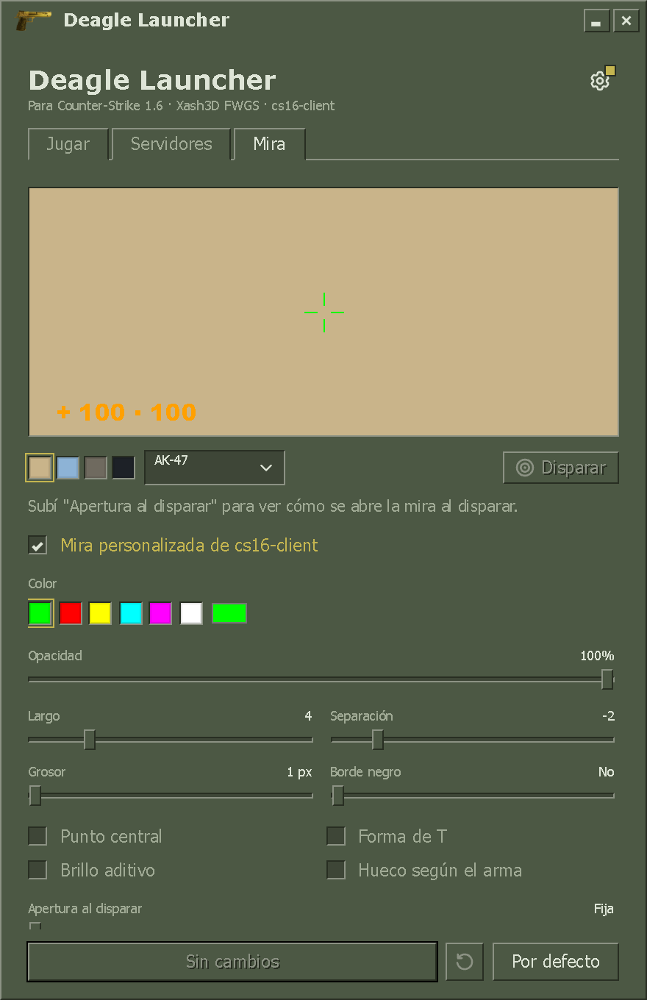
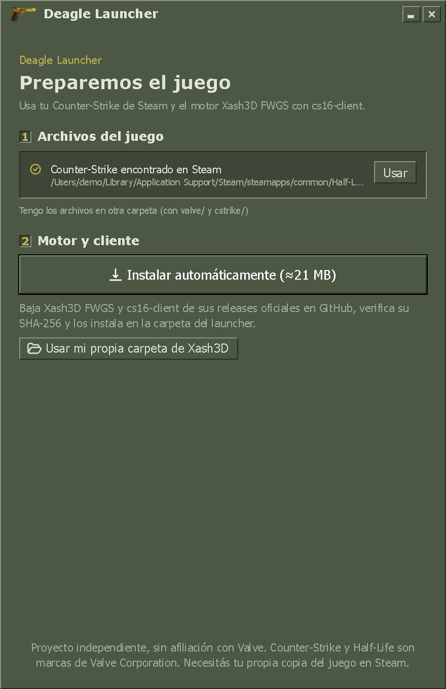
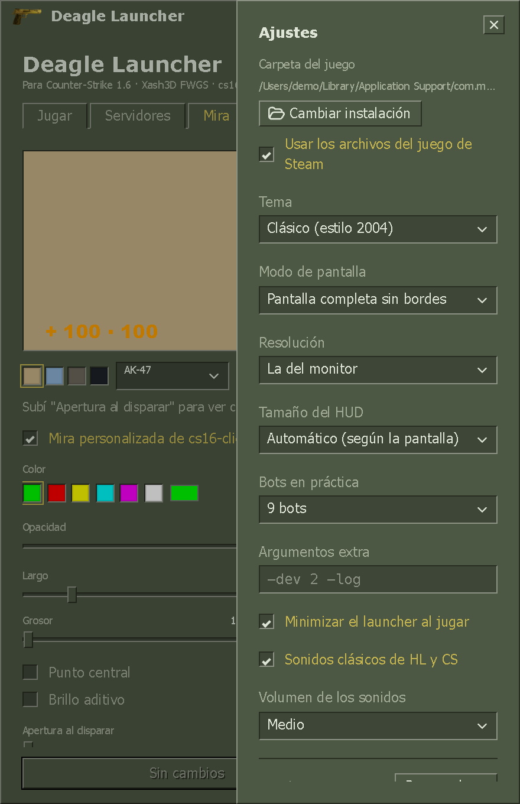

<p align="center">
  
</p>

<h1 align="center">Deagle Launcher</h1>

<p align="center">
  Launcher para jugar <b>Counter-Strike 1.6</b> en tu Mac con Apple Silicon, usando
  <a href="https://github.com/FWGS/xash3d-fwgs">Xash3D FWGS</a> y
  <a href="https://github.com/Velaron/cs16-client">cs16-client</a>.
  <br />
  <a href="https://github.com/mgodoyeclipta/deagle-launcher/releases/latest"><b>⬇ Descargar la última versión</b></a>
</p>

Instalás, elegís tu nombre y jugás: el launcher prepara el motor por vos, usa tu Counter-Strike de Steam, te muestra los servidores argentinos en vivo y te deja armar tu mira antes de entrar.

<table>
  <tr>
    <td align="center"><br /><sub>Jugar</sub></td>
    <td align="center"><br /><sub>Servidores en vivo</sub></td>
    <td align="center"><br /><sub>Editor de mira</sub></td>
  </tr>
</table>

<sub>Capturas con datos de ejemplo: los nombres, IPs y jugadores de los servidores son ficticios.</sub>

- [Para jugadores](#para-jugadores)
- [Para desarrolladores](#para-desarrolladores)
- [Aviso legal](#aviso-legal) · [Licencia](#licencia)

---

# Para jugadores

## Qué necesitás

- Una Mac con **Apple Silicon** (M1 o posterior) y **macOS 11** o superior.
- **Counter-Strike en Steam** ([página de la tienda](https://store.steampowered.com/app/10/CounterStrike/)). Deagle Launcher **no incluye ni descarga el juego**: usa tu copia.

Nada más: el motor y el cliente los instala el launcher.

## Descargar e instalar

1. Entrá a la [**última release**](https://github.com/mgodoyeclipta/deagle-launcher/releases/latest) y bajá el archivo `Deagle.Launcher_<versión>_aarch64.dmg` (sección *Assets*).
2. Abrí el `.dmg` y arrastrá **Deagle Launcher** a **Aplicaciones**.
3. **La primera vez macOS la va a bloquear**, porque la app no está firmada con una cuenta paga de Apple Developer. Para abrirla:
   - hacé **clic derecho sobre la app → Abrir → Abrir**, o
   - en **Ajustes del Sistema → Privacidad y seguridad**, tocá **Abrir igual**, o
   - desde la Terminal:
     ```bash
     xattr -dr com.apple.quarantine "/Applications/Deagle Launcher.app"
     ```

Si querés comprobar que el archivo es el original, cada release publica su **SHA-256**:

```bash
shasum -a 256 ~/Downloads/Deagle.Launcher_*_aarch64.dmg
```

## La primera vez



El launcher te guía en dos pasos:

1. **Archivos del juego.** Busca tu Counter-Strike en Steam y lo usa directamente, sin copiar nada.
   - Si tenés Steam pero no el juego, el botón **Instalar en Steam** abre la instalación; el launcher se da cuenta solo cuando termina.
   - Si tenés los archivos en otra carpeta (con `valve/` y `cstrike/`), elegila con *"Tengo los archivos en otra carpeta"*.
2. **Motor y cliente.** Tocá **Instalar automáticamente (≈21 MB)**. Baja Xash3D FWGS y cs16-client de sus páginas oficiales, verifica que los archivos no estén alterados y los instala.

Listo: **Ir al launcher**.

<br clear="right" />

## Cómo se usa

### Jugar
- **Tu nombre** y **monitor**.
- **Continuar:** vuelve al último servidor en el que jugaste (te muestra el mapa, los jugadores y el ping).
- **Práctica con bots:** una partida local con bots en un mapa al azar (🔀 cambia el mapa).
- **Abrir juego:** el menú de siempre.

Mientras jugás el launcher se minimiza y vuelve cuando cerrás el juego.

### Servidores
- **Argentina:** más de 300 servidores argentinos con nombre, mapa, jugadores y ping **en vivo**.
- **Internet**, **Historial** (los que usaste en el juego) y **Favoritos**.
- **Buscador** por nombre, mapa o IP (por ejemplo `dust2` o `automix`), orden por jugadores, ping o nombre, y filtros para ocultar vacíos o llenos.
- Tocá un servidor para ver **quién está jugando**; doble clic o **Conectar** para entrar.
- ⭐ para guardarlo en favoritos. En **Favoritos** también podés pegar una IP (`45.235.98.52:27038` o `connect 45.235.98.52:27038`).
- **GameTracker** abre la ficha del servidor en el navegador.

### Mira
Armá tu mira con **vista previa en vivo**: color, opacidad, largo, separación, grosor, borde, punto, forma de T y cuánto se abre al disparar (mantené **Disparar** para verlo). También podés editar la mira clásica de CS y el **color del HUD**. **Guardar en el juego** la aplica la próxima vez que abras el juego.

### Ajustes (⚙)



Tema **Clásico** (estilo Steam 2004) o **Moderno**, modo de pantalla, resolución, **tamaño del HUD**, cantidad de bots, sonidos y volumen, minimizar al jugar, actualizaciones y **Créditos**.

<br clear="right" />

## Problemas comunes

| Me pasa que… | Qué hacer |
|---|---|
| macOS dice que la app "no se puede abrir" | Clic derecho → **Abrir** (ver [Descargar e instalar](#descargar-e-instalar)). |
| El HUD se ve muy chico | Ajustes → **Tamaño del HUD** → *Automático* o *Grande (2×)*. Pasa en pantallas Retina. |
| El juego abre en la pantalla de la Mac y no en mi monitor | Por ahora el motor siempre abre en la pantalla principal. Podés cambiar la pantalla principal en Ajustes del Sistema → Pantallas (moviendo la barra de menú). |
| El juego se cierra solo a los pocos segundos | Revisá que **cs16-client** esté completo (Ajustes → **Cambiar instalación**) o reinstalá con *Instalar automáticamente*. Si sigue, copiá el error que muestra el launcher. |
| No suenan los botones | Ajustes → **Sonidos clásicos**. Los sonidos salen de tu Counter-Strike de Steam. |
| Quiero ver qué pasó en el juego | El registro está en `~/Library/Logs/com.mgodoy.deaglelauncher/game.log`. |

## Actualizar

Cuando hay versión nueva, el launcher te avisa (y un punto aparece en ⚙). Bajá el `.dmg` nuevo y reemplazá la app en Aplicaciones: **tus ajustes se conservan**. En **Ajustes → Actualizaciones** también ves si hay versiones nuevas del motor y del cliente.

## Desinstalar

1. Borrá **Deagle Launcher** de Aplicaciones.
2. Si querés borrar también sus datos (ajustes, motor instalado y registros):
   ```bash
   rm -rf ~/Library/Application\ Support/com.mgodoy.deaglelauncher ~/Library/Logs/com.mgodoy.deaglelauncher
   ```

Tu Counter-Strike de Steam no se toca.

---

# Para desarrolladores

¿Querés sumar algo? Bienvenido. Esto es lo que necesitás para arrancar.

## Stack

- **[Tauri 2](https://tauri.app/)** (Rust) para la app nativa: procesos, archivos, red UDP, descargas.
- **React 19 + Vite + TypeScript** para la interfaz, con **Tailwind v4** y **[HeroUI v3](https://heroui.com/)**.

## Primeros pasos

Requisitos: [Rust](https://rustup.rs/) (stable), Node 20+ y las Xcode Command Line Tools.

```bash
git clone https://github.com/mgodoyeclipta/deagle-launcher.git
cd deagle-launcher
npm install
npm run tauri dev      # app nativa con recarga en caliente
```

Otros comandos:

```bash
npm run dev            # solo la interfaz en el navegador, con datos simulados
npx tsc --noEmit       # chequeo de tipos
cd src-tauri && cargo test
npm run tauri build    # .app y .dmg de release en src-tauri/target/release/bundle/
```

## Modo navegador (sin la app nativa)

Con `npm run dev` y `http://localhost:1420`, la interfaz usa una **simulación** de todo lo nativo ([`src/lib/platform.ts`](src/lib/platform.ts), `mockPlatform`): servidores falsos, instalación con progreso simulado, mira, Steam, etc. Sirve para trabajar la UI sin compilar Rust. Parámetros útiles en la URL:

| Parámetro | Simula |
|---|---|
| `?crash` | que el juego se cierra con error |
| `?steam=none` / `?steam=nocs` | sin Steam / Steam sin Counter-Strike |
| `?installfail` | que falla la instalación automática |
| `?discord` | que hay una aplicación de Discord configurada (muestra su interruptor) |

Para empezar de cero en el navegador: `localStorage.clear()` en la consola. Los servidores de la simulación tienen nombres y jugadores inventados: no los muestres junto a nombres o IPs de servidores reales (por ejemplo en capturas).

## Estructura

```
docs/screenshots/            capturas del README (modo navegador, datos ficticios)
src/                         Interfaz (React)
  App.tsx                    fases: cargando → configuración → principal; detección de Steam e instalación
  components/
    SetupScreen.tsx          asistente de primera vez (archivos del juego + motor y cliente)
    MainScreen.tsx           pestañas Jugar / Servidores / Mira, lanzamiento y Discord
    ServerBrowser.tsx        explorador de servidores, buscador, favoritos
    CrosshairEditor.tsx      editor de mira con vista previa
    SettingsDrawer.tsx       ajustes, actualizaciones, créditos
    Credits.tsx · TitleBar.tsx · MonitorPicker.tsx
  lib/
    platform.ts              ÚNICO punto de contacto con Tauri (y su simulación)
    types.ts                 tipos compartidos con Rust
    servers.ts               listas de servidores (Argentina, Internet) y utilidades
    crosshair.ts             modelo y geometría de la mira (réplica de cs16-client)
    updates.ts               chequeo de versiones contra GitHub
    sfx.ts · wav.ts          sonidos de la interfaz (decodificador WAV propio)
    presence.ts              texto de Discord Rich Presence
  themes/skins.css           tema clásico (estilo Steam 2004) sobre las clases de HeroUI

src-tauri/src/               App nativa (Rust)
  commands.rs                comandos que la interfaz llama con invoke()
  game.rs                    chequeo de la instalación, config.cfg (cvars), sonidos, versiones
  launch.rs                  argumentos del motor, lanzar xash3d, evento al cerrar
  installer.rs               descarga + verificación SHA-256 + instalación del motor y cliente
  steam.rs                   detección de Steam y Counter-Strike (app 10)
  a2s.rs                     consultas A2S a los servidores (info y jugadores)
  discord.rs                 Discord Rich Presence por IPC

servers/argentina.json       lista curada de servidores argentinos
```

## Cómo funciona

- **Interfaz ↔ Rust:** la UI nunca llama a Tauri directo, siempre a través de [`platform.ts`](src/lib/platform.ts). Si agregás un comando en Rust, sumalo en `commands.rs`, registralo en `lib.rs`, exponelo en la interfaz `Platform` y dale una versión simulada.
- **Lanzar el juego:** `launch.rs` arma la línea de comandos de `xash3d` (`-game cstrike`, modo de ventana, `-rodir` para los datos de Steam, `+connect`, `-dll @yapb +map … +yb_quota N` para bots). La salida va a un archivo de log, no a un pipe, para que el juego no muera si se cierra el launcher.
- **Datos del juego:** nunca se copian. Si vienen de Steam, el motor los lee en modo solo lectura con `-rodir` y escribe configs solo en la carpeta de instalación.
- **`config.cfg`:** el launcher solo escribe una lista cerrada de cvars (nombre, mira, HUD), con valores validados, con el juego cerrado y dejando antes una copia en `config.cfg.deagle.bak`.
- **Instalador:** baja las releases `continuous` oficiales y **no instala nada cuyo SHA-256 no coincida con el que publica GitHub**. Instala en `~/Library/Application Support/com.mgodoy.deaglelauncher/installs/oficial` y guarda la versión anterior.
- **Servidores:** los datos en vivo salen de **consultar cada servidor directamente** (protocolo A2S de Valve). No se leen datos de sitios de terceros.

## Tests

```bash
cd src-tauri && cargo test
```

Algunos tests tocan cosas reales y están marcados `#[ignore]`; se corren a mano:

```bash
cargo test live_query -- --ignored --nocapture          # A2S contra servidores reales (A2S_SERVERS="ip:puerto,…")
cargo test live_detect -- --ignored --nocapture         # detección de Steam en tu Mac
cargo test real_install -- --ignored --nocapture        # descarga e instalación reales desde GitHub
DEAGLE_PKG_DIR=<carpeta con los paquetes> cargo test extract_official -- --ignored
```

## Sumar servidores argentinos

La pestaña **Argentina** sale de [`servers/argentina.json`](servers/argentina.json). El launcher combina la copia incluida en la app con la de `main` en GitHub, así que **un PR mergeado llega a todos sin sacar versión nueva**.

```json
{ "address": "45.235.98.52:27038", "name": "PUBLICO III + RESPAWN · Nostalgia Gamers Argentina" }
```

Solo servidores **públicos** de Counter-Strike 1.6 que estén en Argentina.

## Publicar una release

1. Subí la versión en `package.json`, `package-lock.json`, `src-tauri/Cargo.toml` y `src-tauri/tauri.conf.json`.
2. `npx tsc --noEmit && (cd src-tauri && cargo test)`.
3. `npm run tauri build`. Si falla el paso del `.dmg` (`hdiutil`), puede quedar montada una imagen temporal `rw.*.dmg`: desmontá **solo esa** (`hdiutil info` para ver cuál) y volvé a compilar.
4. Commit, push y `gh release create vX.Y.Z "src-tauri/target/release/bundle/dmg/Deagle Launcher_X.Y.Z_aarch64.dmg"` con notas para jugadores y el SHA-256 del `.dmg`.

## Reglas del proyecto

Para que el proyecto pueda seguir público, hay límites que **no se cruzan**:

- **Nada de archivos de Valve** en el repo ni en la app (mapas, modelos, sonidos, texturas, íconos, `.res`). Se leen siempre desde la copia del usuario.
- **No descargar el juego** de sitios de terceros ni saltearse Steam.
- **No leer ni scrapear** sitios de terceros (por ejemplo GameTracker): solo enlazarlos.
- **Gratis**, sin funciones pagas (la licencia del Half-Life SDK que usa cs16-client lo exige).
- No usar "Counter-Strike" como nombre del producto ni logos de Valve o Steam.

## Ideas y pendientes

- Elegir monitor: falta un parche al motor (`-display N` en `VID_CreateWindow`, `engine/platform/sdl2/vid_sdl2.c`).
- Discord Rich Presence: el código está, falta el ID de la aplicación de Discord en [`discord.rs`](src-tauri/src/discord.rs).
- Actualizar el motor y el cliente con un clic, y volver a la versión anterior.
- Firmar y notarizar la app con Apple Developer.

---

## Aviso legal

Deagle Launcher es un proyecto independiente y gratuito, **sin afiliación ni respaldo de Valve Corporation ni de Magnum Research**.

- Counter-Strike, Half-Life, Steam y sus logos son marcas registradas de Valve Corporation.
- Desert Eagle es una marca registrada de Magnum Research, Inc. "Deagle" se usa solo como apodo popular del arma dentro del juego.
- Este repositorio no contiene ni distribuye archivos del juego. El launcher solo lee los archivos de la copia de Steam de cada usuario, incluidos los sonidos de la interfaz.
- Xash3D FWGS (GPL-3.0), cs16-client (GPL-2.0+ con excepción para el motor de Half-Life, más la licencia del Half-Life SDK) y YaPB (MIT) son proyectos de terceros con sus propias licencias. El launcher no los incluye: los descarga de sus releases oficiales a pedido del usuario, o usa los que el usuario ya tiene.

## Licencia

Deagle Launcher es software libre bajo la [GNU General Public License v3.0](LICENSE) o posterior (`GPL-3.0-or-later`).
